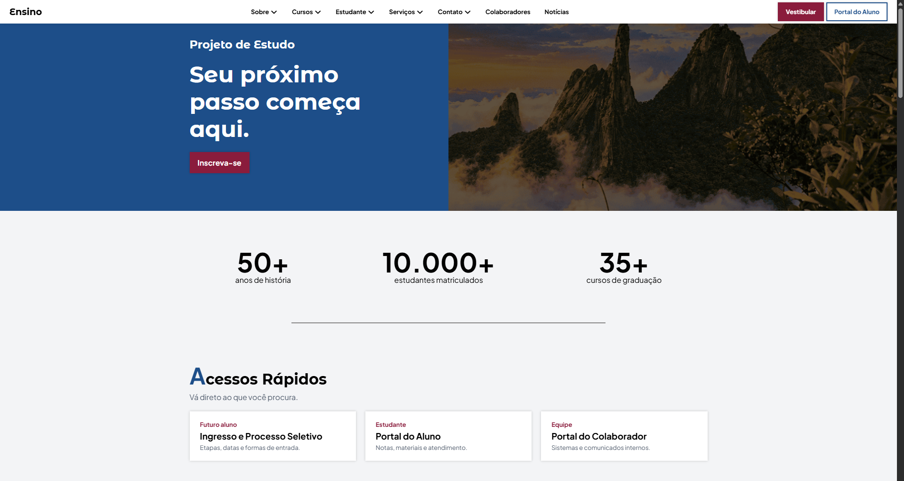
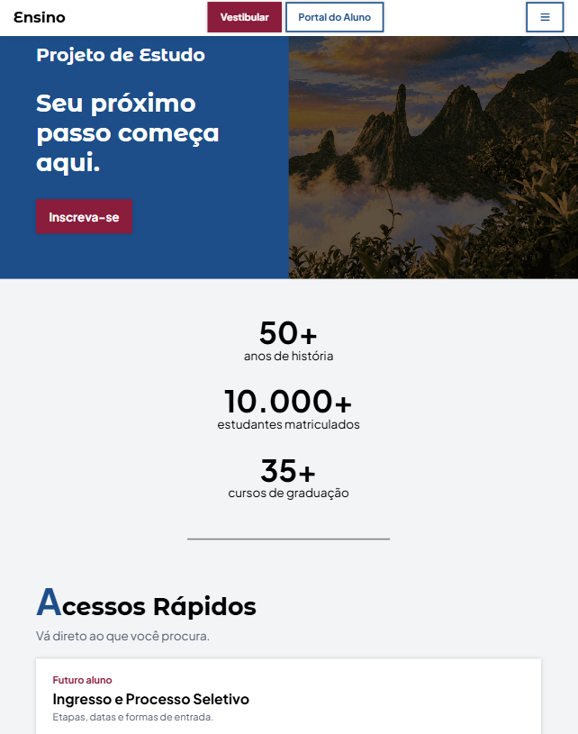

# Site Institucional — Projeto de Estudo

Página inicial de um site institucional de ensino, criada como **projeto de estudo** de desenvolvimento web (HTML, CSS e JavaScript). A instituição é fictícia e o conteúdo é genérico, feito apenas para praticar layout, responsividade e interações.

> **Aviso:** este projeto não tem vínculo com nenhuma instituição real. Textos, números e nomes são exemplos.

## Pré-visualização




## Funcionalidades

- Layout **responsivo**, com pontos de quebra em 1300px, 768px e 480px
- **Menu hambúrguer** em telas pequenas, com cabeçalho fixo
- **Números animados** que contam do zero até o valor final ao aparecerem na tela
- **Carrossel de destaques** com autoplay e navegação por toque
- **Animações ao rolar** a página
- Seções variadas: acessos rápidos, destaques, cursos, motivos para escolher a instituição, serviços, pesquisa e extensão e notícias
- Cards com efeitos de hover e botões padronizados
- Paleta de cores definida por **variáveis CSS**

## Tecnologias

| Uso | Ferramenta |
|---|---|
| Estrutura e estilo | HTML5 e CSS3 (Grid, Flexbox, variáveis CSS, media queries) |
| Interação | JavaScript puro |
| Carrossel | [Swiper](https://swiperjs.com/) |
| Animações ao rolar | [AOS](https://michalsnik.github.io/aos/) |
| Contador animado | [CountUp.js](https://inorganik.github.io/countUp.js/) |
| Ícones | [Font Awesome](https://fontawesome.com/) |
| Fontes | [Google Fonts](https://fonts.google.com/) (Plus Jakarta Sans e Montserrat Alternates) |

As bibliotecas são carregadas por CDN, então é preciso estar conectado à internet para o site funcionar por completo.

## Estrutura do projeto

```text
.
├── index.html
├── css/
│   └── style.css
├── js/
│   └── script.js
├── assets/
│   └── img/
```

## Como executar

1. Baixe ou clone o repositório:
   ```bash
      git clone https://github.com/mrcoan/site-institucional-estudo.git
   ```
2. Abra o arquivo `index.html` no navegador.

Se usar o VS Code, a extensão **Live Server** atualiza a página automaticamente a cada alteração.

## O que pratiquei neste projeto

- Organização de CSS por seções e uso de variáveis
- Layouts com Grid e Flexbox
- Design responsivo e menu para dispositivos móveis
- Uso de bibliotecas de terceiros (Swiper, AOS e CountUp.js)
- Eventos e manipulação de classes com JavaScript
- Boas práticas de acessibilidade, como texto alternativo nas imagens e HTML semântico

## Créditos

- Imagens: [Pixabay](https://pixabay.com/), usadas conforme a [Licença de Conteúdo do Pixabay](https://pixabay.com/service/license-summary/)
- Bibliotecas, ícones e fontes listados acima, cada um com sua respectiva licença

## Autor

**Marco Antonio** — [GitHub](https://github.com/mrcoan) · [LinkedIn](https://www.linkedin.com/in/mrcoan/)
